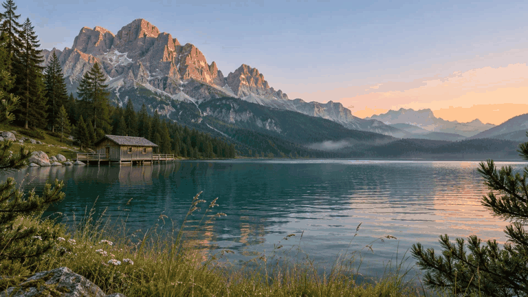
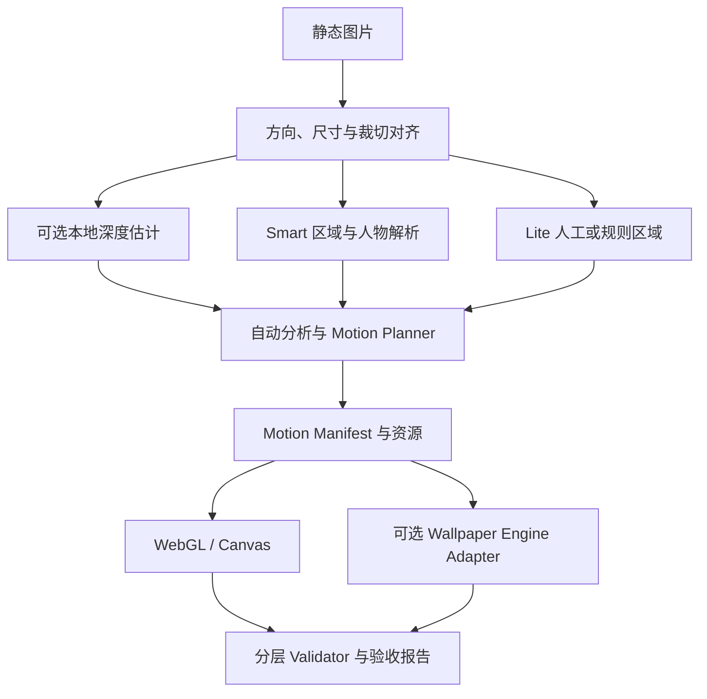

# Static2Live

[简体中文](README.md) | [English](README_EN.md)

**把静态图片变成可交互动态壁纸。**

Static2Live 在本地分析图片，通过深度、区域蒙版和程序化运动生成实时壁纸。支持离线 Web 与可选的 Wallpaper Engine 原生场景输出。

`v1.0.0` · Python 3.10+ · MIT 代码许可

[快速开始](#快速开始) · [核心功能](#核心功能) · [工作原理](#工作原理) · [文档](#文档)



Web 运行时实际录制。程序生成的 CC0 风景配合显式已知深度，指针左右移动时近远区域产生不同位移。此演示使用 Lite 与外部深度图。[原始图片](assets/demo/landscape-source.png)

## 效果展示

### 局部运动与保护


程序绘制的人物示意，使用 Lite、显式头发区域和面部保护蒙版，在 Web 中演示发梢局部 UV 运动。蒙版由示例代码提供，人物模型准确度另有真实照片验收记录。[原始图片](assets/demo/portrait-source.png)

### 环境粒子


同一幅风景上的程序化雪粒子，使用 Lite 与 Web Canvas。素材和全部动态帧由本项目生成。

三组 GIF 均录制自实际 Web 运行时，统一为 768×512、约 12 FPS、5 秒。深度和区域属于显式测试数据，来源与复现步骤见[演示说明](assets/demo/README.md)。

## 项目简介

输入一张图片后，Static2Live 统一方向、尺寸与裁切坐标，读取本地深度模型、区域模型或用户蒙版，再生成可检查的运动规划和资源清单。WebGL 和 Canvas 根据这些资源实时响应指针和时间。

Python 包与 CLI 负责分析和生成。附带的薄 skill 将自然语言要求映射为 Preset、区域和参数，调用同一套 CLI。你也可以直接使用命令行或 YAML。

## 核心功能

| 功能 | 可以做什么 | 1.0 状态 |
| --- | --- | --- |
| 深度视差 | 以局部 UV 位移和有界采样响应鼠标 | 已实现，真实照片与浏览器验证 |
| Lite | 手工区域、规则候选、可选外部深度 | 已实现，关闭视差可完全无模型 |
| Smart | 本地预测人物、天空、水面，支持人物细分类 | 已实现，预测需检查及按需修正 |
| 发梢与衣料 | 根部锚定、局部权重及保护区域 | 已实现，已有对应照片用户反馈 |
| 粒子与区域效果 | 雨、雪、尘、雾、Glow、Cloud Drift | Web 已实现，原生支持范围见下文 |
| 离线区域编辑 | 画笔、擦除、保护、运动源、撤销及缩放 | 已实现，编辑后重新生成 |
| 自动规划 | 根据区域证据推荐 Preset 与保守运动参数 | 已实现，显式用户配置优先 |
| 高级运行时 | 可选音频响应、性能档、虚拟 viewport、局部 Shader | 已实现，验收与宿主支持分别记录 |
| 原生 Adapter | 使用本机合法模板与编译器输出完整场景依赖 | 已实现，依赖 Wallpaper Engine 环境 |

## 快速开始

安装依赖首次需要联网。准备模型需要显式下载，生成与 Web 播放可离线运行。以下命令从仓库根目录执行。

### A. 先体验粒子，无需模型

Windows PowerShell，Python 3.10+。

```powershell
git clone https://github.com/win520-1206/static2live.git
cd static2live
python -m venv .venv
.\.venv\Scripts\python.exe -m pip install .
.\.venv\Scripts\python.exe -m static2live --help
.\.venv\Scripts\python.exe -m static2live assets/demo/landscape-source.png --mode lite --no-parallax --effect dust
```

首次结果位于 `output/landscape-source/v001/`。双击其中的 `index.html` 查看，检查报告保存在 `validation.json`。再次生成会得到 `v002/` 等新目录。

PyPI 连接缓慢时，可在本次安装命令末尾加 `--index-url https://pypi.tuna.tsinghua.edu.cn/simple` 使用清华镜像。本轮干净环境安装采用该镜像验证完成。

Linux/macOS 可用 `.venv/bin/python` 替换 Python 路径。当前实际宿主验收来自 Windows，原生 Adapter 面向本机 Wallpaper Engine 安装环境。

### B. 准备本地模型，体验深度视差

沿用上一步虚拟环境，安装 PyTorch、Transformers 等可选依赖，再显式准备深度模型。

```powershell
.\.venv\Scripts\python.exe -m pip install ".[depth]"
.\.venv\Scripts\python.exe -m static2live models prepare --kind depth --model-cache models
.\.venv\Scripts\python.exe -m static2live assets/demo/landscape-source.png --mode lite --model-cache models --output output/depth
```

模型缓存在 `models/`，结果位于 `output/depth/landscape-source/v001/`。默认 CPU，支持显式 `--device cuda`。模型准备完成后的生成只读缓存。

已有深度图可使用 `--depth-map depth.png`。深度图须匹配 EXIF 转正后的原图尺寸，8 位单通道、白色更近。首次下载慢时可显式使用国内镜像，仍校验官方 revision 与哈希，详见[模型准备](references/workflow.md#下载慢时换国内镜像)。

生成失败时先查看 CLI 错误及 `validation.json`，再读[工作流](references/workflow.md)或[原生排错](references/native-qa.md)。

## 工作原理



`analyzer.py` 统一像素与区域来源，`planning.py` 推荐运动，`motion.py` 描述画布和参数。Renderer 消费生成资源，Adapter 处理宿主依赖，Validator 核对配置、哈希及运行证据。详细实现见[自动规划](docs/V1.0_IMPLEMENTATION.md)。

## 常见用法

下面用 `static2live` 表示已激活环境中的命令。也可替换为 `.\.venv\Scripts\python.exe -m static2live`。

```powershell
# 只分析并推荐，关闭视差可省去深度模型
static2live analyze --input photo.jpg --no-parallax

# 创建离线区域编辑器，保存 regions.json 后重新生成
static2live annotate --input photo.jpg --output annotations
static2live photo.jpg --mode lite --no-parallax --regions regions.json --effect dust

# 已准备模型后自动识别人物、天空和水面
static2live photo.jpg --mode smart --preset warm_portrait --model-cache models

# 本地人物解析及可选原生场景输出
static2live photo.jpg --mode smart --human-parsing --target wallpaper-engine --model-cache models

# 横屏取景，顶部优先保留头顶
static2live photo.jpg --crop-aspect 16:9 --crop-anchor top
```

Smart 及人物解析首次需分别准备 segmentation 和 human-parsing 模型，并接受对应许可。具体命令见[人物解析](docs/V0.4_IMPLEMENTATION.md)和[完整工作流](references/workflow.md)。

优先级为 CLI > 用户 YAML > 所选 Preset > 自动建议 > 默认值。`--strength` 的单位是画布短边比例，最大 `0.01`。发梢与衣料参数使用画布像素，详细单位见工作流。用户关闭效果或设置零强度会保留在配置中。

## 输出结构

```text
output/landscape-source/v001/
├── index.html
├── style.css
├── runtime.js
├── effects.js
├── assets/
├── config.yaml
├── analysis.json
├── motion.json
├── manifest.json
└── validation.json
```

`index.html` 是离线 Web 入口，`assets/` 保存图像及按需生成的深度和蒙版。`analysis.json` 记录来源与推荐，`motion.json` 记录动画，`manifest.json` 记录版本与资源哈希，`validation.json` 保存检查状态。

原生目标另有 `native-plan.json` 和 `wallpaper-engine/project.json`。无可用引擎、模板或编译器时保留 Web 输出，并记录 `actual:web` 和 warning。实际编译错误会报错。原生粒子及属性支持、未映射项以 `native-plan.json` 为准。

## 验证体系

| 层级 | 检查内容 | 证据 |
| --- | --- | --- |
| Structural | 资源、尺寸、参数、引用及哈希 | 自动结构检查 |
| Browser Runtime | WebGL 启动、像素变化、边缘、零强度及降级 | 实际 Chromium 运行 |
| Visual Acceptance | 连续性、自然度及局部伪影 | 明确版本的人工观察 |
| Native Runtime | 宿主加载、交互、属性及能力分项 | 实际 Wallpaper Engine 观察 |

状态采用 `passed / warning / failed / not_tested`。生成、浏览器和人工观察分别记录，每个新 Manifest 保留自身验收状态。截图证据单独版本化。

2026-11-17 的 1.0 本地安装包完整回归为 **220 项通过**，包含启用的合成浏览器测试。最终源码包核心与 skill 工作流另有 28 项通过。真实照片、独立原生音频及实体双屏证据的范围见[1.0 说明](docs/V1.0_RELEASE.md)和[需求审计](docs/V1_REQUIREMENT_AUDIT.md)，原始私人素材及本机记录保留在维护者本机。

## 功能状态与限制

- 相对深度用于有界原图采样，遮挡后的背景仍不可见。人物解析是粗类别预测，散发和边缘可能需要人工修正。
- 自动推荐较保守。已认可的 Smart 样例整体自然、人物连续且脸稳定，默认衣料的独立可辨性仍需按素材确认。
- 原生已接入视差、人物局部运动、全画布雨雪尘雾、属性及可选音频/Shader。局部粒子、Glow、Cloud Drift 等 Web 能力按原生输出的 unsupported 记录处理，两个运行目标呈现可能存在差异。
- Web 支持性能档与归一化虚拟 viewport；原生性能和裁切由宿主管理。精确原生硬件 FPS、显存及多实例时钟同步仍缺测量或验收。
- 后续范围包括树木自动识别、独立光线束、精细发丝 Alpha Matting、背景补全、表情和视频导出。
- skill 已有实际主 Agent 使用与 CLI 配方测试，独立 Agent 行为评估尚待执行。

## 开发与测试

沿用上述环境安装开发依赖。

```powershell
.\.venv\Scripts\python.exe -m pip install ".[dev]"
.\.venv\Scripts\python.exe -m pytest -q

# 完整浏览器测试需显式安装 Chromium 并开启
$env:PLAYWRIGHT_BROWSERS_PATH = "$PWD/.browsers"
.\.venv\Scripts\python.exe -m playwright install chromium
$env:STATIC2LIVE_BROWSER_TESTS = '1'
.\.venv\Scripts\python.exe -m pytest -q
```

未开启浏览器测试时，对应项目会跳过。编辑安装可用 `pip install -e ".[dev]"`，Windows 中文路径遇到安装编码问题时可使用普通安装。

通过 [Issues](https://github.com/win520-1206/static2live/issues) 报告复现步骤、版本、配置与受影响目标，通过 [Pull requests](https://github.com/win520-1206/static2live/pulls) 提交修改。贡献时保留原图、旧输出和模型许可来源，使用合成测试素材，提交前检查私人文件与密钥。

## Roadmap

- [x] 1.0 分析、规划、双目标输出与验证闭环。
- [x] 人工区域编辑、Smart 真实模型和已受验人物微动态。
- [ ] 扩充可公开的真实照片演示及人物边缘案例。
- [ ] 补齐原生硬件性能测量与多屏连续拼接测试。
- [ ] 独立 Agent 的 skill 行为评估。
- [ ] 逐步完善原生支持矩阵、CI 与发行流程。

## 隐私、许可与致谢

生成和播放在本地执行，首次依赖安装及显式模型准备需要网络。原图保持完整，新输出使用独立版本目录。图片公开展示的权利由素材使用者确认。

| 资源 | 许可与来源 |
| --- | --- |
| Static2Live 代码 | [MIT](LICENSE) |
| README 演示图及 GIF | 本项目程序生成，CC0，见[素材说明](assets/demo/README.md) |
| Depth Anything V2 Small HF | Apache-2.0，按[官方模型卡](https://huggingface.co/depth-anything/Depth-Anything-V2-Small-hf)与实际缓存记录使用 |
| SegFormer B0 ADE | NVIDIA SegFormer 许可，限非商业研究/评估，见[官方模型卡](https://huggingface.co/nvidia/segformer-b0-finetuned-ade-512-512) |
| FASHN Human Parser | NVIDIA SegFormer 许可，限非商业研究/评估，见[官方模型卡](https://huggingface.co/fashn-ai/fashn-human-parser) |
| Wallpaper Engine 模板与素材 | 按引擎来源许可本地使用，软件分发包排除这些资产 |

感谢 Depth Anything、SegFormer、FASHN、Pillow、NumPy、PyTorch、Transformers 与 Wallpaper Engine 提供的模型或工具。详细使用与再分发要求见[模型和素材许可](docs/MODEL_LICENSE.md)。

## 文档

| 文档 | 内容 |
| --- | --- |
| [1.0 交付说明](docs/V1.0_RELEASE.md) | 当前能力、验收依据与限制 |
| [需求审计](docs/V1_REQUIREMENT_AUDIT.md) | 原规格映射与历史证据范围 |
| [skill 入口](SKILL.md) | 自然语言请求到 CLI 的编排 |
| [完整工作流](references/workflow.md) | 模式、模型、配置、构图与单位 |
| [原生排错与验收](references/native-qa.md) | 加载、黑屏、粒子和属性检查 |
| [开发能力](references/development.md) | 解析、保护及能力分项 |
| [运动原语](docs/MOTION_PRIMITIVES.md) | 区域 Shader 与约束 |
| [人物解析](docs/V0.4_IMPLEMENTATION.md) | 发梢、衣料和保护的实现记录 |
| [蒙版编辑器](docs/V0.5_IMPLEMENTATION.md) | 绘制、保存与再生成 |
| [高级运行时](docs/V0.6_IMPLEMENTATION.md) | 音频、性能、多屏与 Shader |
| [自动分析与规划](docs/V1.0_IMPLEMENTATION.md) | 分析器与 Motion Planner |
