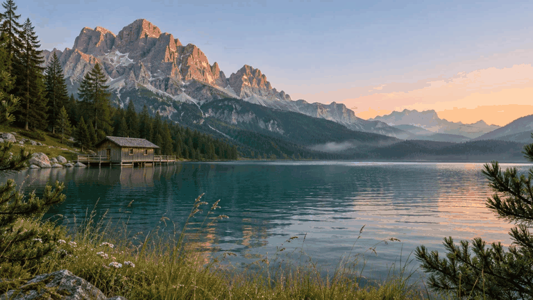
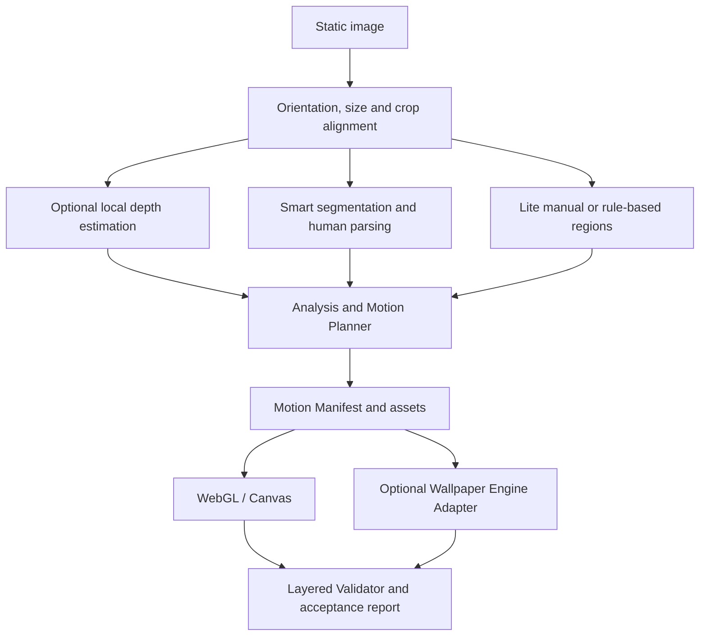

# Static2Live

[简体中文](README.md) | [English](README_EN.md)

**Turn still images into interactive live wallpapers.**

Static2Live analyzes images locally and builds real-time wallpapers with depth, region masks, and procedural motion. Export offline Web wallpapers or optional native Wallpaper Engine scenes.

`v1.0.0` · Python 3.10+ · MIT-licensed code

[Quick Start](#quick-start) · [Features](#features) · [Architecture](#architecture) · [Documentation](#documentation)



Captured from the actual Web runtime. A CC0 procedural landscape and explicit known depth produce different pointer-driven displacement across near and far regions. This example uses Lite with a supplied depth map. [Source image](assets/demo/landscape-source.png)

## Demos

### Local motion and protection


A procedurally drawn character uses Lite, an explicit hair region, and a protected face mask to demonstrate local Web UV motion. The example code supplies its masks. Real-photo model quality has separate acceptance records. [Source image](assets/demo/portrait-source.png)

### Environmental particles


Procedural snow over the same landscape, using Lite and Web Canvas. Both the source artwork and animated frames are generated by this project.

All three GIFs capture the actual Web runtime at 768×512, approximately 12 FPS, for 5 seconds. Depth and regions are explicit test data. Sources and reproduction instructions are documented in the [demo notes](assets/demo/README.md).

## Overview

Static2Live aligns image orientation, dimensions, and crop coordinates, then reads local depth models, region models, or user masks to produce inspectable motion plans and asset manifests. WebGL and Canvas render those assets in response to pointer input and time.

The Python package and CLI perform analysis and generation. A thin skill maps natural-language requests to Presets, regions, and parameters and calls the same CLI. You can also work directly with the CLI or YAML.

## Features

| Feature | What it provides | 1.0 status |
| --- | --- | --- |
| Depth parallax | Pointer response through local UV displacement and bounded sampling | Implemented, real-photo and browser validation |
| Lite | Manual regions, rule-based candidates, optional supplied depth | Implemented, fully model-free with parallax disabled |
| Smart | Local person/sky/water prediction and optional human parsing | Implemented, predictions require inspection and possible correction |
| Hair and clothing | Anchored roots, local weights, and protected regions | Implemented, corresponding photo feedback recorded |
| Particles and regional effects | Rain, snow, dust, fog, Glow, and Cloud Drift | Implemented on Web, native scope documented below |
| Offline region editor | Paint, erase, protection, motion sources, undo, and zoom | Implemented, regenerate after editing |
| Automatic planning | Evidence-based Preset and restrained motion recommendations | Implemented, explicit user configuration takes precedence |
| Advanced runtime | Optional audio response, performance profiles, virtual viewport, local shaders | Implemented, acceptance and host support tracked separately |
| Native Adapter | Complete scene dependencies using local licensed templates and compiler | Implemented, requires a Wallpaper Engine environment |

## Quick Start

Initial dependency installation needs network access. Model preparation is an explicit download step. Generation and Web playback can run offline. Run these commands from the repository root.

### A. Try particles without models

Windows PowerShell, Python 3.10+.

```powershell
git clone https://github.com/win520-1206/static2live.git
cd static2live
python -m venv .venv
.\.venv\Scripts\python.exe -m pip install .
.\.venv\Scripts\python.exe -m static2live --help
.\.venv\Scripts\python.exe -m static2live assets/demo/landscape-source.png --mode lite --no-parallax --effect dust
```

The first output is `output/landscape-source/v001/`. Double-click its `index.html` to view it. Checks are stored in `validation.json`. Subsequent generation creates `v002/` and further independent versions.

For slow PyPI connections, append `--index-url https://pypi.tuna.tsinghua.edu.cn/simple` to this installation command to use the Tsinghua mirror. The clean-environment installation in this round was verified with that mirror.

On Linux/macOS, substitute `.venv/bin/python`. Actual host acceptance currently comes from Windows. The native Adapter targets a local Wallpaper Engine installation.

### B. Prepare a local model for depth parallax

Reuse the environment above, install the optional PyTorch/Transformers dependencies, and explicitly prepare the depth model.

```powershell
.\.venv\Scripts\python.exe -m pip install ".[depth]"
.\.venv\Scripts\python.exe -m static2live models prepare --kind depth --model-cache models
.\.venv\Scripts\python.exe -m static2live assets/demo/landscape-source.png --mode lite --model-cache models --output output/depth
```

The model cache is `models/`. Output is `output/depth/landscape-source/v001/`. CPU is the default, with explicit `--device cuda` support. Generation reads the prepared local cache.

A supplied map can be passed through `--depth-map depth.png`. It must match the EXIF-oriented input dimensions, use an 8-bit single channel, and encode nearer regions as white. Slow downloads can explicitly use a domestic mirror while retaining official revision/hash checks. See [model preparation](references/workflow.md#下载慢时换国内镜像).

For failures, inspect the CLI error and `validation.json`, then consult the [workflow](references/workflow.md) or [native troubleshooting](references/native-qa.md).

## Architecture



`analyzer.py` aligns pixels and region provenance, `planning.py` recommends motion, and `motion.py` defines canvas and parameters. Renderers consume generated assets, the Adapter handles host dependencies, and the Validator checks configuration, hashes, and runtime evidence. See [automatic planning](docs/V1.0_IMPLEMENTATION.md).

## Usage

The examples below use `static2live` from an activated environment. You can substitute `.\.venv\Scripts\python.exe -m static2live`.

```powershell
# Analyze and recommend only; disable parallax to skip the depth model
static2live analyze --input photo.jpg --no-parallax

# Create an offline editor, save regions.json, then regenerate
static2live annotate --input photo.jpg --output annotations
static2live photo.jpg --mode lite --no-parallax --regions regions.json --effect dust

# Predict people, sky, and water after preparing local models
static2live photo.jpg --mode smart --preset warm_portrait --model-cache models

# Local human parsing and optional native scene export
static2live photo.jpg --mode smart --human-parsing --target wallpaper-engine --model-cache models

# Landscape framing with a top-priority crop
static2live photo.jpg --crop-aspect 16:9 --crop-anchor top
```

Smart and human parsing need separately prepared segmentation and human-parsing models and acceptance of their respective licenses. Commands are documented in [human parsing](docs/V0.4_IMPLEMENTATION.md) and the [full workflow](references/workflow.md).

Precedence is CLI > user YAML > selected Preset > automatic suggestions > defaults. `--strength` is a fraction of the canvas short edge, capped at `0.01`. Hair and clothing amplitudes use canvas pixels. The workflow documents detailed units. Explicitly disabled effects and zero strengths are preserved.

## Output

```text
output/landscape-source/v001/
├── index.html
├── style.css
├── runtime.js
├── effects.js
├── assets/
├── config.yaml
├── analysis.json
├── motion.json
├── manifest.json
└── validation.json
```

`index.html` is the offline Web entry point. `assets/` stores the image and applicable depth/maps. `analysis.json` records provenance and recommendations, `motion.json` describes animation, `manifest.json` records versions and hashes, and `validation.json` stores check results.

Native exports add `native-plan.json` and `wallpaper-engine/project.json`. Missing engine/template/compiler prerequisites retain Web output with `actual:web` and a warning. Actual compilation failures raise errors. Consult `native-plan.json` for mapped native particles/properties and unsupported features.

## Validation

| Layer | Checks | Evidence |
| --- | --- | --- |
| Structural | Assets, dimensions, parameters, references, and hashes | Automated structural checks |
| Browser Runtime | WebGL startup, pixel behavior, edges, zero strength, and fallback | Actual Chromium execution |
| Visual Acceptance | Continuity, natural motion, and local artifacts | Human observation of a specific version |
| Native Runtime | Host loading, interaction, properties, and capabilities | Actual Wallpaper Engine observation |

States are `passed / warning / failed / not_tested`. Generation, browser behavior, and human observation are tracked separately. Every new Manifest retains its own acceptance state. Screenshot evidence is independently versioned.

The local 1.0 installed-package regression on 2026-11-17 passed **220 tests**, including enabled synthetic browser tests. The final source-package core/skill workflow passed a further 28 tests. Real-photo, independent native audio, and physical dual-display evidence is scoped in the [1.0 notes](docs/V1.0_RELEASE.md) and [requirements audit](docs/V1_REQUIREMENT_AUDIT.md). Private source photos and raw local records remain on the maintainer's machine.

## Status and limitations

- Relative depth drives bounded sampling of the input. Hidden background remains occluded. Human parsing predicts coarse classes, and loose hair or edges may need manual correction.
- Automatic recommendations are conservative. The accepted Smart sample was reported natural, continuous, and face-stable. Independent visibility of default clothing motion still needs per-image confirmation.
- Native mapping covers parallax, human local motion, full-canvas rain/snow/dust/fog, properties, and optional audio/shaders. Web features such as local particles, Glow, and Cloud Drift are handled according to native unsupported records. Appearance can differ between targets.
- Web supports performance profiles and normalized virtual viewports. Native performance and cropping are host-managed. Precise native hardware FPS, VRAM, and multi-instance clock synchronization still need measurement or acceptance.
- Future scope includes automatic tree recognition, independent light rays, fine hair Alpha Matting, background completion, facial expressions, and video export.
- Skill evidence includes actual primary-Agent usage and runnable CLI recipes. Independent Agent behavioral evaluation remains pending.

## Development and tests

Install development dependencies in the environment above.

```powershell
.\.venv\Scripts\python.exe -m pip install ".[dev]"
.\.venv\Scripts\python.exe -m pytest -q

# Full browser tests require explicit Chromium installation and opt-in
$env:PLAYWRIGHT_BROWSERS_PATH = "$PWD/.browsers"
.\.venv\Scripts\python.exe -m playwright install chromium
$env:STATIC2LIVE_BROWSER_TESTS = '1'
.\.venv\Scripts\python.exe -m pytest -q
```

Browser cases are skipped without opt-in. Editable installation is available through `pip install -e ".[dev]"`. A regular install can avoid editable-install encoding issues on Windows paths containing Chinese characters.

Report reproduction steps, version, configuration, and target in [Issues](https://github.com/win520-1206/static2live/issues), and submit changes through [Pull requests](https://github.com/win520-1206/static2live/pulls). Preserve original inputs, old output, and model-license provenance. Use synthetic fixtures and check for private files and credentials before committing.

## Roadmap

- [x] 1.0 analysis, planning, dual-target output, and validation pipeline.
- [x] Manual region editing, real Smart models, and accepted portrait micro-motion.
- [ ] Expand publicly shareable real-photo demos and human-edge cases.
- [ ] Measure native hardware performance and test continuous multi-display composition.
- [ ] Independently evaluate skill behavior with another Agent.
- [ ] Improve the native support matrix, CI, and release workflow.

## Privacy, licenses, and credits

Generation and playback are local. Initial dependency installation and explicit model preparation need network access. Original images are preserved and new outputs use independent version directories. Users are responsible for securing public-display rights to their images.

| Resource | License and source |
| --- | --- |
| Static2Live code | [MIT](LICENSE) |
| README artwork and GIFs | Procedurally generated by this project, CC0, see [asset notes](assets/demo/README.md) |
| Depth Anything V2 Small HF | Apache-2.0, follow the [official model card](https://huggingface.co/depth-anything/Depth-Anything-V2-Small-hf) and actual cache record |
| SegFormer B0 ADE | NVIDIA SegFormer license, non-commercial research/evaluation, see the [official model card](https://huggingface.co/nvidia/segformer-b0-finetuned-ade-512-512) |
| FASHN Human Parser | NVIDIA SegFormer license, non-commercial research/evaluation, see the [official model card](https://huggingface.co/fashn-ai/fashn-human-parser) |
| Wallpaper Engine templates/assets | Local use under their source license; excluded from software distribution |

Thanks to Depth Anything, SegFormer, FASHN, Pillow, NumPy, PyTorch, Transformers, and Wallpaper Engine for their models or tools. See [model and asset licenses](docs/MODEL_LICENSE.md) for usage and redistribution details.

## Documentation

| Document | Contents |
| --- | --- |
| [1.0 delivery notes](docs/V1.0_RELEASE.md) | Current capabilities, acceptance basis, and limitations |
| [Requirements audit](docs/V1_REQUIREMENT_AUDIT.md) | Original specification mapping and historical scope |
| [Skill entry point](SKILL.md) | Natural-language request to CLI orchestration |
| [Full workflow](references/workflow.md) | Modes, models, configuration, framing, and units |
| [Native troubleshooting and QA](references/native-qa.md) | Loading, black screens, particles, and properties |
| [Development capabilities](references/development.md) | Parsing, protection, and capability-level evidence |
| [Motion primitives](docs/MOTION_PRIMITIVES.md) | Regional shaders and constraints |
| [Human parsing](docs/V0.4_IMPLEMENTATION.md) | Hair, clothing, and protection implementation history |
| [Mask editor](docs/V0.5_IMPLEMENTATION.md) | Painting, saving, and regeneration |
| [Advanced runtime](docs/V0.6_IMPLEMENTATION.md) | Audio, performance, displays, and shaders |
| [Automatic analysis and planning](docs/V1.0_IMPLEMENTATION.md) | Analyzer and Motion Planner |
